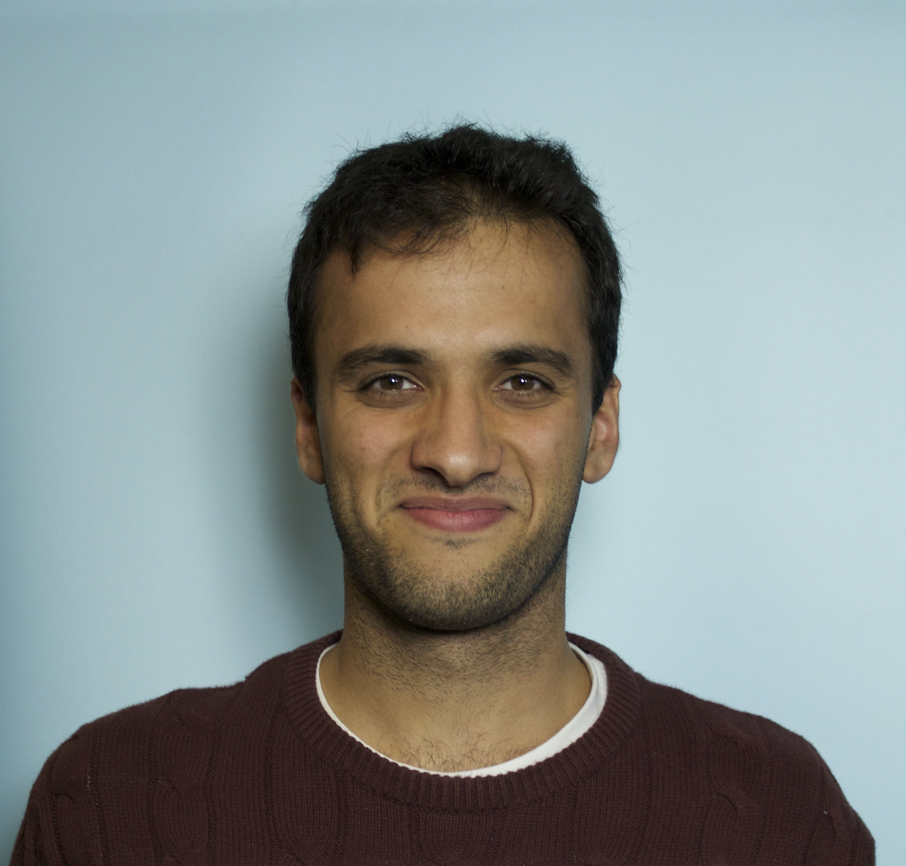

I am an evolutionary biologist and independent research fellow at the Institute of Science and Technology Austria. 

I sit at the interface between genomics and evolutionary theory. Despite the multitude of genomes that have been sequenced over the last decade, understanding how adaptive processes shape their evolution remains a central challenge in evolutionary biology. I use genomic approaches to develop rigorous tests of evolutionary theory -- and generate new predictions in the process. See my [research page](https://filruzicka.github.io/research/) for more.  

  

